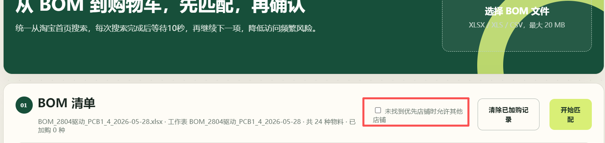

# BOM 淘宝采购助手

根据电路板 BOM 自动解析元器件，按优先店铺在淘宝搜索匹配商品，经人工确认后加入购物车。

> 建议先取消勾选“三家店均无可靠结果时搜索其他店铺”，并在12秒等待期间留意淘宝弹出的验证。




## 1. 启动工具

1. 双击项目目录中的 `启动工具.cmd`。
2. 保持命令窗口开启，关闭该窗口会停止工具。
3. Microsoft Edge 会自动打开 `http://127.0.0.1:3210`。
4. 如果没有自动打开，可以手动在浏览器输入上述地址。

## 2. 登录淘宝

1. 点击页面右上角“打开淘宝并登录 / 验证”。
2. 工具会使用独立的 Microsoft Edge 窗口打开淘宝，请在其中手动完成登录。
3. 如果出现滑块、短信或其他安全验证，需要手动完成，程序不会破解或绕过验证。
4. 登录状态保存在项目的 `.browser-data` 目录，通常下次启动可以继续使用。

## 3. 准备 BOM 文件

支持 `.xlsx`、`.xls` 和 `.csv` 文件，最大 20 MB。程序读取第一个工作表。

支持的列名如下：

| 用途 | 可识别列名 |
| --- | --- |
| 位号 | `Designator`、`Reference`、`Ref`、`RefDes`、`位号`、`元件位号` |
| 型号 | `Model`、`MPN`、`Part Number`、`Manufacturer Part Number`、`型号`、`物料编码`、`器件型号` |
| 参数 | `Value`、`Comment`、`Description`、`参数`、`规格`、`阻值`、`容值`、`描述` |
| 封装 | `Footprint`、`Package`、`Pattern`、`封装`、`器件封装` |
| 数量 | `Quantity`、`Qty`、`Count`、`数量`、`用量` |
| 厂商 | `Manufacturer`、`Mfr`、`Brand`、`厂商`、`制造商`、`品牌` |

至少需要“型号”或“参数”其中一列。

## 4. 搜索值由哪些列组成

每一种物料的淘宝搜索词按照以下顺序组合，并自动忽略空值和重复值：

```text
型号 + 参数 + 封装 + 厂商
```

例如 BOM 内容为：

| 型号 | 参数 | 封装 | 厂商 |
| --- | --- | --- | --- |
| RC0603FR-0710KL | 10K 1% | 0603 | YAGEO |

生成的搜索词为：

```text
RC0603FR-0710KL 10K 1% 0603 YAGEO
```

“位号”不参与搜索，用于展示并合并相同物料；“数量”不参与搜索，用于计算加购数量。如果 BOM 没有数量列，程序会根据位号数量估算。

对于带精确型号的芯片，实际店铺检索会自动尝试三层关键词：先搜索精确型号，再搜索“型号 + 简化封装”，最后搜索完整搜索词。例如 `STM32G031G8U6` 会先单独搜索，不会一开始就附带过长的封装尺寸描述。

## 5. 店铺内搜索与店铺优先级

程序按照以下顺序进入店铺内部搜索页查找元器件：

1. 优信电子
2. 欧贝顿
3. Risym
4. 其他淘宝店铺（勾选“三家店均无可靠结果时搜索其他店铺”时）

每次搜索结果读取完成后，工具会强制等待12秒再发起下一次搜索。设置该等待时间的主要原因是避免短时间内连续请求，使淘宝检测为“频繁访问”，从而触发滑块验证、访问受限或访问被拒绝。等待倒计时会显示在进度区域，期间仍可点击“停止当前任务”。12秒间隔可以降低触发淘宝安全验证的概率，但不能保证完全避免淘宝风控。

如果前一家店找到可靠结果，程序不会继续访问后面的店铺。如果某家店访问被拒绝，会让该店进入30分钟冷却并继续下一家店。只有三家优先店铺都没有可靠结果且允许搜索其他店铺时，才会使用淘宝全站搜索；全站搜索会排除首位广告结果。

### 省运费的推荐设置

首次查找时，建议先取消勾选页面中的“三家店均无可靠结果时搜索其他店铺”。这样工具只在优信电子、欧贝顿和 Risym 三家优先店铺中查找，可以尽量把多个元器件集中在同一家店铺购买，减少拆分订单和重复运费。

推荐操作顺序：

1. 先取消勾选“三家店均无可靠结果时搜索其他店铺”。
2. 执行第一轮匹配，优先确认同一家店铺能够提供的元器件。
3. 将匹配正确的商品加入购物车并记录为“已加购”。
4. 对仍未找到的元器件，再勾选“三家店均无可靠结果时搜索其他店铺”。
5. 重新执行匹配；工具会自动跳过已经加购的元器件，只补搜缺少的部分。

该设置只是采购建议。如果优先店铺的商品价格明显更高、库存不足或型号不准确，应以型号和参数正确为首要条件，再综合比较商品价格与运费。

## 6. 执行匹配

1. 点击“选择 BOM 文件”并上传文件。
2. 检查识别出的位号、型号、参数、封装、数量和搜索词。
3. 取消不需要采购的物料。
4. 点击“开始匹配”。
5. 匹配过程中可以点击“停止当前任务”。已经完成的部分会保留。

如果淘宝要求登录或安全验证，程序会临时暂停查找并保留当前进度。完成验证后，程序会自动从暂停的元器件继续，不会重新搜索前面已经完成的项目。

淘宝出现“亲，请拖动下方滑块完成验证”或地址中包含 `punish`、`x5secdata` 时，工具会识别为安全验证并暂停。请在弹出的 Microsoft Edge 中亲自拖动滑块。验证成功后不要关闭该窗口，工具会自动恢复原搜索页面。

如果店铺页面显示“访问被拒绝”，工具会让该店进入30分钟冷却并继续下一家店。淘宝全站搜索或加购阶段遇到拒绝时会停止任务，避免产生更多失败请求。不要连续刷新拒绝页面。

## 7. 审核结果与加入购物车

1. 检查每项候选商品的店铺、标题、价格和匹配分数。
2. 点击“打开核对”查看淘宝商品详情。
3. 在下拉框中选择正确候选商品，并勾选需要加购的项目。
4. 点击“将已确认项加入购物车”。
5. 加购过程中同样可以点击“停止当前任务”。

成功加入购物车的物料会写入本机 `data/added-items.json`。下次上传相同 BOM 时，这些物料显示为“已加购”并自动跳过，只查找尚未加购的元器件。如需重复采购，可点击“清除已加购记录”。

存在多个 SKU 的商品需要在淘宝页面手动选择阻值、容值、封装或包装数量。工具不会提交订单或付款。手动完成加购后，请在工具的加购结果中点击“我已手动加购”。

## 8. 常见问题

### 页面提示无法访问 127.0.0.1

确认 `启动工具.cmd` 的命令窗口仍然开启，然后刷新页面。

### 一开始检索就停止

查看弹出的淘宝浏览器，通常是需要登录或安全验证。完成后程序会继续当前关键词。

### 匹配结果不准确

优先在 BOM 中填写完整的精确型号，其次填写参数、封装和厂商。电阻、电容建议同时提供参数和封装。

### 修改代码后页面没有变化

关闭原命令窗口并重新双击 `启动工具.cmd`，然后在浏览器中强制刷新页面。

## 注意事项

- 工具不会提交订单或付款。
- 淘宝登录、滑块、短信及其他安全验证必须由用户手动完成。
- 淘宝页面结构发生变化后，商品提取规则可能需要更新。
- 登录信息和已加购记录仅保存在本机，不会上传到项目仓库。
